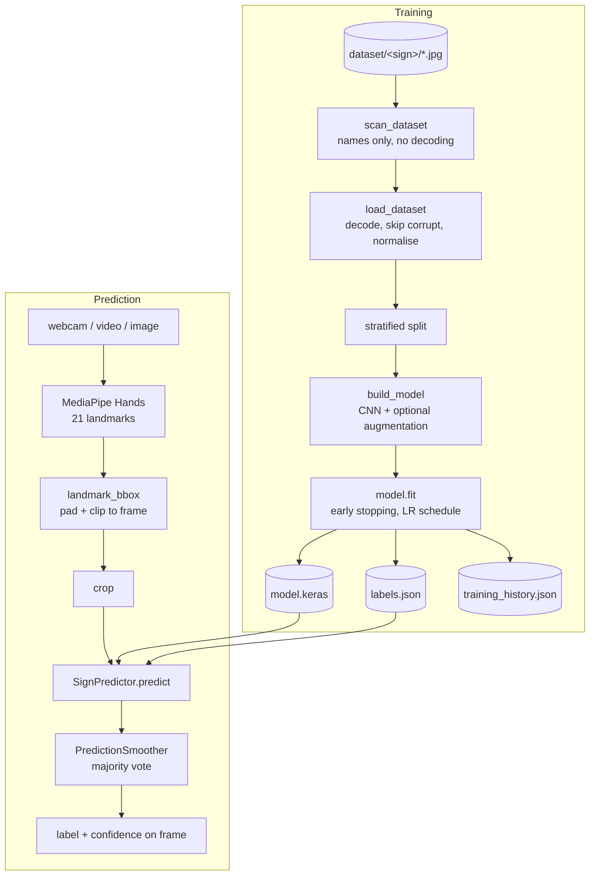

# Architecture

## Overview

The system has two pipelines that share one contract — *an image of a
hand goes in, a sign label comes out* — and one artefact that connects
them: the model file plus its `labels.json`.

## Module map

| Module | Responsibility | Heavy deps imported |
|---|---|---|
| `sign_language/exceptions.py` | `SignLanguageError` hierarchy | — |
| `sign_language/config.py` | Validated `TrainConfig` / `PredictConfig` | — |
| `sign_language/data.py` | Dataset scanning/loading, labels JSON I/O, split | cv2/numpy/sklearn, lazily |
| `sign_language/model.py` | CNN definition, save/load | TensorFlow, lazily |
| `sign_language/predictor.py` | `SignPredictor`, preprocessing, `Prediction` | via `model.py` |
| `sign_language/training.py` | `run_training()` + train CLI | via the modules above |
| `sign_language/inference.py` | stream/image loops + predict CLI | cv2/MediaPipe, lazily |
| `sign_language/utils.py` | bboxes, smoothing, logging, source parsing | — |
| `train.py`, `predict.py` | Thin backwards-compatible wrappers | — |

**Lazy imports are a deliberate design rule**: TensorFlow, OpenCV and
MediaPipe are imported *inside functions*, never at module top level.
Consequences:

- `--help` and argument/config validation work on any machine.
- The unit tests and the dataset checker run without the ML stack.
- A missing dependency becomes a `DependencyError` naming the exact
  `pip install` command, instead of a `ModuleNotFoundError` traceback.

## The model

`build_model()` (in `model.py`) — the original three-block CNN, with
dropout and an explicit `Input` layer added:

| Layer | Output (64×64 input) |
|---|---|
| Conv2D 32, 3×3, ReLU (+ optional augmentation layers before it) | 62×62×32 |
| MaxPooling 2×2 | 31×31×32 |
| Conv2D 64, 3×3, ReLU | 29×29×64 |
| MaxPooling 2×2 | 14×14×64 |
| Conv2D 128, 3×3, ReLU | 12×12×128 |
| MaxPooling 2×2 | 6×6×128 |
| Flatten → Dense 256, ReLU → Dropout 0.5 | 256 |
| Dense *N*, softmax | *N* classes |

Compiled with Adam + sparse categorical cross-entropy. `.keras` is the
default save format; legacy `.h5` files still load.

## The labels contract

Training writes `labels.json` — the class names in model-output order —
next to the model. Prediction loads *that file* (not a dataset folder),
and `SignPredictor` refuses to start if the label count doesn't match
the model's output size. This eliminates the original bug where
prediction re-derived class names from a hard-coded Windows path, so
any rename/reorder of dataset folders silently shifted every label.

## Prediction smoothing

Raw frame predictions flicker between similar signs. `PredictionSmoother`
keeps the last *N* (default 5) labels and displays the majority, trading
a few frames of latency for stable text. Predictions under the
confidence threshold are rendered with a `(?)` suffix.

## Error-handling philosophy

1. **Expected failures are exceptions with instructions.** Everything a
   user can cause — missing dataset/model/labels, corrupt image, busy
   camera, invalid flag values, missing dependency — raises a
   `SignLanguageError` subclass whose message says how to fix it. The
   CLIs catch these, print `ERROR: <message>` and exit `1`.
2. **One bad file never kills a run.** Undecodable images are skipped,
   counted in `LoadReport`, and summarised at the end of training.
3. **Validate at the boundary.** Config dataclasses validate in
   `__post_init__`; dataset preconditions (≥ 2 classes, ≥ 2 images per
   class for a stratified split) are checked *before* any heavy work,
   with messages written for the user, not the library author.
4. **Resources are always released.** Camera, windows and the MediaPipe
   graph close in `finally` blocks — including on errors and `Ctrl+C`
   (exit `130`).
5. **Never fake certainty.** Low-confidence predictions are marked
   `(?)`; a labels/model mismatch is a hard error, not a warning.

Exit codes: `0` success, `1` expected error, `130` keyboard interrupt.
